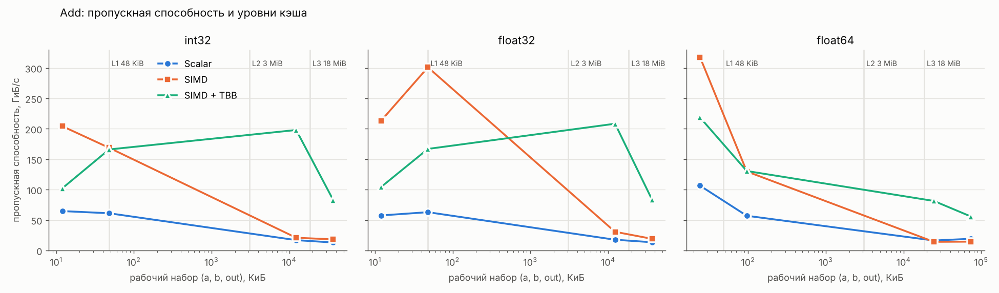
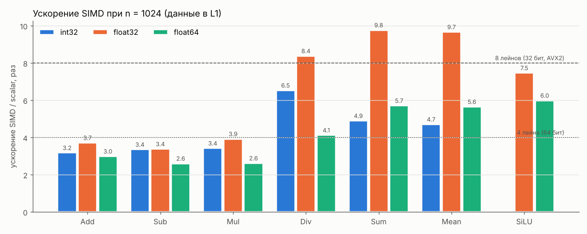
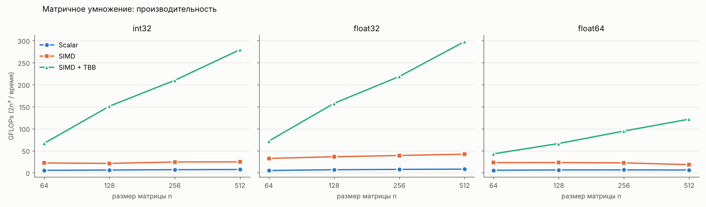

# ДЗ 1. Овсянникова Мария, ПАДИИ-3

## Как собрать и запустить

```bash
cmake -B build -DCMAKE_BUILD_TYPE=Release
cmake --build build -j

./build/tests
./build/benchmarks
```

## Файлы

- `ops.h`: объявления всех функций
- `ops-inl.h`: SIMD-ядра на Highway
- `ops.cpp`: диспетчеризация Highway и параллельные версии на TBB
- `scalar.h`: скалярные версии для сравнения
- `tests.cpp`: тесты корректности
- `benchmarks.cpp`: нагрузочные тесты
- `bench_utils.hpp`, `data_generators.hpp`: из практики l3_simd

## Условия

| | |
|---|---|
| CPU | Intel(R) Core(TM) Ultra 5 225H |
| Логических ядер | 14 |
| Частота | 3686 MHz |
| L1d | 48 KiB на ядро |
| L2 | 3 MiB на ядро |
| L3 | 18 MiB |
| SIMD | AVX2 |
| Система | Ubuntu (WSL2), GCC 13.3, Release |

AVX2 регистры по 256 бит, то есть 8 чисел int32/float32 или 4 числа float64 за одну инструкцию.

## Ход работы

За основу брала практику l3_simd: структуру файлов (`-inl.h` с ядрами + `.cpp` с `foreach_target.h` и `HWY_EXPORT`), обёртки `*_impl<T>` с перегрузками под каждый тип как в `muladd.cpp`, `parallel_for` с `blocked_range` и размером блока `32768 / sizeof(T)` из TODO в `muladd.cpp`, matmul через rank-1 обновление из `matmul-inl.h`. Подсчёт GFLOPs взяла из l2_into_soft.

Реализовано (scalar, SIMD и SIMD + TBB):
- сложение, вычитание, умножение, деление
- сумма и среднее
- SiLU и GELU (только float и double)
- умножение матриц

Типы: int32, float32, float64.

Чтобы не дублировать код, каждая операция записана как маленькая структура с двумя `operator()` - для вектора и для одного числа (хвост массива). Цикл по массиву написан один раз в шаблоне, нужную операцию выбирает `switch` по `enum` до начала цикла. Параллельные версии все используют одну функцию `parallel_blocks`, сумма использует `parallel_reduce`.

Сумму int32 считаю в int64, чтобы не было переполнения.

Сигмоиду из практики (`simd_sigmoid` в `activations_benchmark.cpp`) взять не получилось, т.к. у неё ошибка больше 0.5. Поэтому tanh считаю через рациональную аппроксимацию (ошибка около 1e-4), а сигмоиду через tanh: sigma(x) = 0.5 + 0.5·tanh(x/2).

Скалярные версии собираются с `no-tree-vectorize`, чтобы компилятор сам их не векторизовал.

## Тесты

GoogleTest, 23 теста, все проходят. Каждый тест запускается для int32, float и double (через `TYPED_TEST`) и сравнивает SIMD и SIMD + TBB версии со скалярной.

- Арифметика: размеры 1, 7, 8, 17, 1000, 1023, 4096, 100003 чтобы проверить хвосты, которые не делятся на число лейнов. Целые сравниваются точно, дробные с допуском 1e-6
- Сумма и среднее: ответ сравнивается с суммой, посчитанной обычным циклом в double. Допуск 1e-4 для float, 1e-10 для double, для int32 точно
- SiLU и GELU: x от −10 до 10, допуск 1e-4·max(1, |x|), потому что tanh приближённый
- Matmul: n = 1, 3, 8, 17, 64, 100, 129, матрицы из маленьких целых от −3 до 3, поэтому результат должен совпасть точно для всех типов

## Измерения

Google Benchmark. Для поэлементных операций размеры 1024, 4096, 1M, 3M элементов, для matmul n = 64, 128, 256, 512. Смотрела на время, пропускную способность (байт в секунду) и для matmul на GFLOPs = 2n³ / время.

Сколько памяти занимают три массива у Add и куда они помещаются:

| n | int32 / float32 | float64 |
|---|---|---|
| 1024 | 12 KiB, L1 | 24 KiB, L1 |
| 4096 | 48 KiB, на границе L1 | 96 KiB, L2 |
| 1M | 12 MiB, L3 | 24 MiB, уже не помещается в L3 |
| 3M | 36 MiB, память | 72 MiB, память |

## Результаты

Ускорение относительно scalar, в ячейке SIMD / SIMD + TBB:

| Операция | Тип | n = 1024 | n = 4096 | n = 1M | n = 3M |
|---|---|---|---|---|---|
| Add | int32 | ×3.2 / ×1.6 | ×2.8 / ×2.7 | ×1.2 / ×11.6 | ×1.4 / ×6.3 |
| Add | float32 | ×3.7 / ×1.8 | ×4.8 / ×2.7 | ×1.7 / ×11.8 | ×1.4 / ×6.2 |
| Add | float64 | ×3.0 / ×2.1 | ×2.3 / ×2.3 | ×0.9 / ×4.6 | ×0.8 / ×2.7 |
| Sub | int32 | ×3.4 / ×1.6 | ×2.6 / ×2.7 | ×1.7 / ×13.1 | ×1.1 / ×6.1 |
| Sub | float32 | ×3.4 / ×1.5 | ×5.4 / ×2.9 | ×1.6 / ×11.1 | ×1.0 / ×6.0 |
| Sub | float64 | ×2.6 / ×1.8 | ×2.4 / ×2.1 | ×1.0 / ×4.4 | ×0.7 / ×2.3 |
| Mul | int32 | ×3.4 / ×1.6 | ×2.9 / ×3.0 | ×1.8 / ×12.8 | ×1.6 / ×6.6 |
| Mul | float32 | ×3.9 / ×1.8 | ×5.9 / ×3.1 | ×1.7 / ×11.5 | ×1.4 / ×5.7 |
| Mul | float64 | ×2.6 / ×1.7 | ×2.4 / ×2.3 | ×0.6 / ×4.0 | ×0.7 / ×2.7 |
| Div | int32 | ×6.5 / ×5.7 | ×6.7 / ×6.4 | ×3.5 / ×17.4 | ×3.2 / ×15.2 |
| Div | float32 | ×8.4 / ×4.4 | ×8.3 / ×6.8 | ×2.0 / ×12.6 | ×1.4 / ×5.9 |
| Div | float64 | ×4.1 / ×3.5 | ×3.9 / ×3.9 | ×0.7 / ×2.8 | ×0.7 / ×2.7 |
| Sum | int32 | ×4.9 / ×2.3 | ×5.3 / ×4.1 | ×3.1 / ×15.1 | ×2.4 / ×15.7 |
| Sum | float32 | ×9.8 / ×3.8 | ×10.2 / ×6.6 | ×7.1 / ×33.7 | ×4.4 / ×26.3 |
| Sum | float64 | ×5.7 / ×3.1 | ×4.2 / ×3.5 | ×3.0 / ×7.7 | ×2.6 / ×9.6 |
| Mean | int32 | ×4.7 / ×2.6 | ×5.2 / ×4.1 | ×3.0 / ×13.8 | ×2.3 / ×14.9 |
| Mean | float32 | ×9.7 / ×4.2 | ×9.4 / ×6.5 | ×7.0 / ×32.4 | ×4.0 / ×24.5 |
| Mean | float64 | ×5.6 / ×2.8 | ×4.4 / ×3.7 | ×2.9 / ×9.3 | ×2.2 / ×9.8 |
| SiLU | float32 | ×7.5 / ×6.5 | ×7.2 / ×7.0 | ×7.5 / ×40.0 | ×3.8 / ×25.9 |
| SiLU | float64 | ×6.0 / ×5.2 | ×5.9 / ×5.8 | ×3.0 / ×14.0 | ×3.7 / ×13.2 |
| GELU | float32 | ×23.8 / ×20.6 | ×33.0 / ×29.7 | ×53.3 / ×276.1 | ×30.6 / ×206.3 |
| GELU | float64 | ×13.8 / ×11.3 | ×18.8 / ×18.1 | ×18.9 / ×75.6 | ×18.9 / ×71.1 |





Matmul, ускорение SIMD / SIMD + TBB:

| Тип | n = 64 | n = 128 | n = 256 | n = 512 |
|---|---|---|---|---|
| int32 | ×4.0 / ×12.1 | ×3.4 / ×24.5 | ×3.5 / ×29.9 | ×3.4 / ×37.9 |
| float32 | ×6.3 / ×14.0 | ×5.3 / ×22.9 | ×5.1 / ×28.4 | ×5.1 / ×36.2 |
| float64 | ×4.1 / ×7.6 | ×3.6 / ×10.2 | ×3.5 / ×14.5 | ×2.9 / ×19.0 |

GFLOPs при n = 512:

| Тип | Scalar | SIMD | SIMD + TBB |
|---|---|---|---|
| int32 | 7.4 | 24.8 | 279.4 |
| float32 | 8.2 | 42.2 | 297.8 |
| float64 | 6.3 | 18.5 | 121.7 |



## Выводы

- Сложение, вычитание, умножение почти ничего не считают, но много читают и пишут в память. Пока массивы в L1 (1024 и 4096 элементов), SIMD ускоряет в 3–6 раз. На 1M и 3M SIMD почти не помогает (×1–1.7), потому что всё упирается в скорость памяти, а для float64 на больших размерах SIMD даже чуть медленнее scalar, 24 MiB уже не влезают в L3. Работает только TBB: несколько ядер вместе читают память быстрее, получается до ×11–13.

- TBB на маленьких массивах хуже, чем просто SIMD. На 1024 элементах весь массив - это один блок, и время уходит на запуск потоков. Например, Add float32: SIMD ×3.7, а SIMD + TBB только ×1.8.

- Сумма ускоряется сильнее (до ×10 для float32). В скалярном цикле каждое сложение ждёт предыдущее, а в SIMD идут 8 независимых сумм параллельно. Для int32 меньше (×5), потому что сумма считается в int64, т.е. 4 числа в регистре. Среднее почти совпадает с суммой.

- Деление. у float32 даёт ×8.4. У int32 в AVX2 нет векторного целочисленного деления, Highway делает его через float, но это всё равно в 6.5 раз быстрее скалярного деления.

- SiLU и GELU: тут много вычислений на каждое число, поэтому SIMD даёт ускорение близкое к числу лейнов (SiLU float32 ×7.5) и не проседает на больших массивах. У GELU ускорение огромное (×24–53), но это нечестно сравнивать: скалярная версия вызывает точный `std::tanh`, а SIMD приближение. С TBB активации ускоряются почти пропорционально числу ядер.

- float64 везде ускоряется меньше, потому что в регистр помещается в 2 раза меньше чисел, и массивы в 2 раза раньше перестают помещаться в кэш.

- Matmul при n = 512 для float32: scalar 8 GFLOPs, SIMD 42, SIMD + TBB 298. Однопоточная SIMD-версия почти не растёт с n: на каждом шаге она загружает и сохраняет строку C, и упирается в чтение из кэша. Можно было бы ускорить разбиением на блоки, как в OpenBLAS из l2_into_soft.

